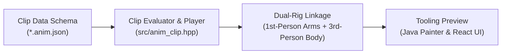

# Voxel FPS Engine 0.0

An authoritative, deterministic, high-performance voxel-based tactical first-person shooter engine and mission editor built with C++20 and Vulkan, paired with an embedded React/TypeScript Command Center ([`recov-iui`](../recov-iui)) and a desktop Java Swing Voxel Painter ([`java/painter`](java/painter)).

---

## 1. Core Architecture & Philosophy

The engine is engineered around strict boundaries defined in [`RULES.md`](RULES.md):

* **Cubic Unit Grid Authority:** Canonical $1\text{ mm}$ ($VOXEL\_SIZE = 0.001\text{ m}$) cubic voxels are the sole authority for physics collision, bullet trajectories, volumetric destruction, and line-of-sight raycasts. No smoothed or derived rendering surfaces ever feed back into simulation logic.
* **View / Sim Separation:** The engine separates into an **authoritative simulation** (`sim::World`, movement, ballistics, structural stability) and one or more **view processes** (Vulkan presentation, WebView2 editor, Java painter). The simulation pushes filtered snapshots; the view processes hold no world grid and cannot mutate world state directly.
* **Deterministic Verification & Exit Codes:** headlessly regression-tested via golden hashes and exit gates (Exit 1: Exception, Exit 2: Movement, Exit 3: JSON, Exit 4: Map loader, Exit 5: Mesh workers, Exit 6: Ballistics, Exit 7: Incomplete run, Exit 8: Pause/Eye interp, Exit 9: Visual params, Exit 10: Terrain, Exit 11: Character mesh, Exit 12: Sublattice impacts, Exit 13: Structural integrity matrix).

---

## 2. Layered Aesthetic & Visual Pipeline

Rendering is structured into strict non-interfering layers:

| Layer | Owner | Holds | Simulation Access |
| :--- | :--- | :--- | :--- |
| **Occupancy** | Simulation | Authoritative material per unit cell (solid, water, air) | **Sole Authority** |
| **Appearance** | Sim &rarr; View | Per-cell palette index and emissive tags sent in snapshots | None |
| **Surface** | View | Meshes derived from cells: greedy quads, AO, photographic CC0 textures | None |
| **Entities** | Simulation | Spawn points, pickups, lights, NPCs, events | Simulation State Only |
| **Models** | View | Humanoid character rig and weapon voxel meshes | None |
| **Effects** | View | Sub-lattice debris chips, muzzle flash, ricochet sparks | None |
| **Environment** | View | Sky dome, dynamic moon vector, point light bulbs | None |
| **Overlay** | View | HUD, inventory lattice, Dear ImGui & WebView2 overlays | None |

### Performance Baseline
* **Mesh Worker Pool:** Multithreaded chunk remeshing (`meshview::Workers`) running snapshot, build, and copy phases asynchronously.
* **Stress Profile:** Under full stress (600 ticks, 200 shotgun blasts, 1,400 simultaneous pellets, 600+ live debris chips), average frame time is **$\sim 0.86\text{ ms}$** ($\sim 1100\text{ FPS}$ headroom) with peak frames well below the $16.6\text{ ms}$ budget.

---

## 3. Implemented Systems & Features

### Structural Integrity Matrix System
* Housed in [`src/structural_matrix.hpp`](src/structural_matrix.hpp).
* Evaluates structural load-bearing capacity for designated building zones (Zone 1: Warehouse Main Bay).
* **Member Categorization:**
  * **Girders (`Block::Girder`):** Steel framing, roof trusses, and crane rails (35% weight).
  * **Pillars (`Block::Concrete` at $y \ge 2$):** Primary vertical load-bearing columns (45% weight).
  * **Walls (`Block::SheetMetal`, `Block::Wood`, `Block::WoodDark` at $y \ge 2$):** Shear resistance and perimeter stability (20% weight).
  * **Slab ($y \le 1$):** Foundation anchor.
* Evaluates real-time intact ratios, overall integrity index $I \in [0.0, 1.0]$, stress factor $1.0 - I$, and transitions across 5 operational tiers (`Nominal`, `Stressed`, `Compromised`, `Critical`, `Collapsed`).
* Verified deterministically via self-test gate (Exit Code 13).

### Weapons Catalog & Ballistics
* **10 Discrete Ammo Types across 4 Calibers:**
  * **Light:** 9mm Sidearm (`weapon_sidearm_light`), SMG (`weapon_smg_light`), Shotgun (`weapon_shotgun_light`).
  * **Medium:** Starter Rifle (`weapon_starter_rifle`), DMR (`weapon_dmr_medium`), LMG (`weapon_lmg_medium`).
  * **Heavy:** Sniper Rifle (`weapon_sniper_heavy`), Heavy Cannon (`weapon_cannon_heavy`).
  * **Energy:** Energy Carbine (`weapon_energy_carbine`), Energy Beam (`weapon_energy_beam`).
* **Modular Parts System:** Action/Receiver, Barrel, Stock/Grip, Magazine Well, Sight/Optics.
* **Procedural Handling Dynamics:** Smooth Aim Down Sights (ADS), sprint/walk bobbing, critical spring-damper recoil recovery, and reload cycles.

### Character Rigging & Kinematics
* **16 mm Sub-Lattice Character Model:** Model-space voxel lattice partitioned into 17 body regions with a 20-bone skeletal hierarchy.
* **Kinematics:** Stances (Stand, Crouch, Prone, Slide, Dash with invulnerability frames, Wall-run) and gaits (Walk, Run, Sprint) with contralateral limb counter-swinging and stamina fatigue breathing.

### Tooling & Frontends
1. **React Command Center (`recov-iui/apps/command-center`):**
   * Embedded WebView2 editor (`--mode editor`).
   * Live structural integrity monitor, weapon catalog equip & bake controls, character stance rig testing, material sculpting palette, and engine telemetry.
2. **Java Voxel Painter (`java/painter`):**
   * Standalone desktop voxel art suite.
   * Model editor, character rigging, map format v2 persistence, and direct 10-weapon model stamping into maps.

---

## 4. Authored Animation Pipeline (Roadmap)

Transitioning procedural animation into keyframed, authored animation clips follows a 4-step pipeline:



1. **Step 1: Clip & Keyframe Data Schema (`data/anims/*.anim.json`):** JSON format defining skeletal bone tracks, timestamps, position vectors, and rotation quaternions.
2. **Step 2: Animation Clip Evaluator & Player (`src/anim_clip.hpp`):** Linear and spherical interpolation (`slerp`), clip blending, and additive procedural overlays.
3. **Step 3: Dual-Perspective Rig Linkage:** Connecting authored clips to first-person viewmodel weapon bones (slide cycle, magazine detach) and third-person skinned character meshes.
4. **Step 4: Tooling & Timeline Scrubber:** Exposing timeline controls and clip triggers in both the React Command Center and Java Painter.

---

## 5. Building & Testing

### Prerequisites
* Windows 10/11 x64
* Clang / LLVM toolchain + Visual Studio Build Tools
* Vulkan SDK (glslc)
* Java JDK 17+ (for Java Painter)
* Node.js & pnpm (for Command Center frontend)

### Common Commands
```powershell
# Build C++ engine
.\scripts\build.ps1

# Run all automated validation gates
.\launch.ps1 -Action SmokeAll

# Run load & performance stress testing
.\launch.ps1 -Action Stress

# Run Java painter smoke test
.\scripts\smoke_painter.ps1

# Run view isolation anti-cheat compilation check
.\scripts\check_view_isolation.ps1
```
