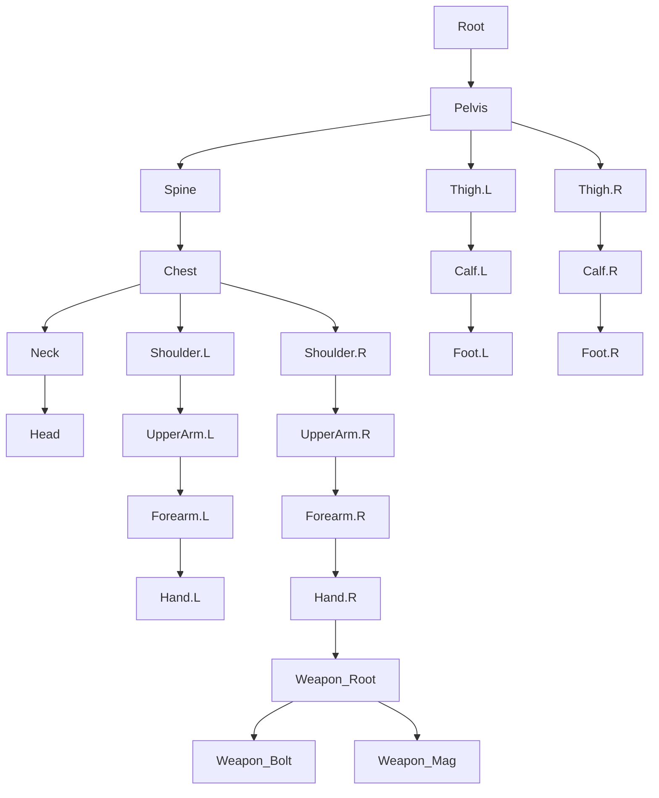

# Blender Rigging, Animation, and Character Modeling

## Overview

This guide documents the integration between **Blender 4.0+ / 5.x** and the **Voxel FPS Engine**. It covers the canonical skeletal hierarchy, coordinate system conversions, character mesh skinning (16 mm sub-lattice), and bi-directional animation exchange via `.anim.json`.

---

## 1. Coordinate Space Conversions

Blender and the Voxel Engine use different right-handed coordinate systems:

| Axis | Blender Convention | Voxel Engine Convention |
| :--- | :--- | :--- |
| **Up** | $+Z$ | $+Y$ |
| **Forward** | $+Y$ | $+Z$ |
| **Right** | $+X$ | $+X$ |

### Vector Position Mapping
$$\begin{aligned}
\mathbf{p}_{\text{engine}} &= (x_b,\; z_b,\; -y_b) \\
\mathbf{p}_{\text{blender}} &= (x_e,\; -z_e,\; y_e)
\end{aligned}$$

### Quaternion Rotation Mapping
In C++ [`anim::Quat`](file:///c:/Users/gryph/kepler/worktrees/voxel-salva-6d28d/src/anim_clip.hpp) and Blender `mathutils.Quaternion`:
$$\begin{aligned}
(x_e,\; y_e,\; z_e,\; w_e) &= (x_b,\; z_b,\; -y_b,\; w_b) \\
(w_b,\; x_b,\; y_b,\; z_b) &= (w_e,\; x_e,\; -z_e,\; y_e)
\end{aligned}$$

---

## 2. Canonical Skeletal Rig

The engine defines a canonical 20-bone humanoid skeleton plus 3 weapon accessory bones. The unit cell size for character sub-lattice joints is `kCellSize = 0.016m` (16 mm).



### Bone Mapping & Alias Table
The engine's [`normalizeBoneNameForEngine()`](file:///c:/Users/gryph/kepler/worktrees/voxel-salva-6d28d/src/anim_clip.hpp) automatically handles common naming conventions from Blender, Rigify, and Mixamo:

| Bone Index | Engine Channel | Blender Canonical | Rigify (`DEF-`) | Mixamo Format |
| :---: | :--- | :--- | :--- | :--- |
| **0** | `root` | `Root` | `root` | `mixamorig:Hips` (or root) |
| **1** | `pelvis` | `Pelvis` | `DEF-pelvis` | `mixamorig:Hips` |
| **2** | `spine` | `Spine` | `DEF-spine` | `mixamorig:Spine` / `Spine1` |
| **3** | `chest` | `Chest` | `DEF-chest` | `mixamorig:Spine2` |
| **4** | `neck` | `Neck` | `DEF-neck` | `mixamorig:Neck` |
| **5** | `head` | `Head` | `DEF-head` | `mixamorig:Head` |
| **6** | `l_shoulder` | `Shoulder.L` | `DEF-shoulder.L` | `mixamorig:LeftShoulder` |
| **7** | `l_upper_arm` | `UpperArm.L` | `DEF-upper_arm.L` | `mixamorig:LeftArm` |
| **8** | `l_forearm` | `Forearm.L` | `DEF-forearm.L` | `mixamorig:LeftForeArm` |
| **9** | `l_hand` | `Hand.L` | `DEF-hand.L` | `mixamorig:LeftHand` |
| **10** | `r_shoulder` | `Shoulder.R` | `DEF-shoulder.R` | `mixamorig:RightShoulder` |
| **11** | `r_upper_arm` | `UpperArm.R` | `DEF-upper_arm.R` | `mixamorig:RightArm` |
| **12** | `r_forearm` | `Forearm.R` | `DEF-forearm.R` | `mixamorig:RightForeArm` |
| **13** | `r_hand` | `Hand.R` | `DEF-hand.R` | `mixamorig:RightHand` |
| **14** | `l_thigh` | `Thigh.L` | `DEF-thigh.L` | `mixamorig:LeftUpLeg` |
| **15** | `l_calf` | `Calf.L` | `DEF-shin.L` | `mixamorig:LeftLeg` |
| **16** | `l_foot` | `Foot.L` | `DEF-foot.L` | `mixamorig:LeftFoot` |
| **17** | `r_thigh` | `Thigh.R` | `DEF-thigh.R` | `mixamorig:RightUpLeg` |
| **18** | `r_calf` | `Calf.R` | `DEF-shin.R` | `mixamorig:RightLeg` |
| **19** | `r_foot` | `Foot.R` | `DEF-foot.R` | `mixamorig:RightFoot` |
| **20** | `weapon_root` | `Weapon_Root` | - | - |
| **21** | `weapon_bolt` | `Weapon_Bolt` | - | - |
| **22** | `weapon_mag` | `Weapon_Mag` | - | - |

---

## 3. Inverse Kinematics (IK) Setup

When generating the armature via `tools/blender/voxel_rig_anim.py`, four 2-bone IK chains are automatically generated with pole targets:

1. **Left Arm:** `Forearm.L` constrained to `IK_Hand.L` (chain length 2), guided by `Pole_Elbow.L`.
2. **Right Arm:** `Forearm.R` constrained to `IK_Hand.R` (chain length 2), guided by `Pole_Elbow.R`.
3. **Left Leg:** `Calf.L` constrained to `IK_Foot.L` (chain length 2), guided by `Pole_Knee.L`.
4. **Right Leg:** `Calf.R` constrained to `IK_Foot.R` (chain length 2), guided by `Pole_Knee.R`.

---

## 4. Character Mesh & Skinning (16 mm Sub-Lattice)

The character mesh generated by `create_character_mesh()` faithfully reflects the engine's 17 body regions:
- **136 vertices** (8 corners per body box) and **19 vertex groups** (all deforming humanoid bones).
- Weights are mathematically identical to [`char_mesh::computeBoneWeights()`](file:///c:/Users/gryph/kepler/worktrees/voxel-salva-6d28d/src/char_mesh.hpp):
  - Primary bone receives $1.0 - (\text{blendFactor} \times 0.5)$.
  - Secondary bone receives $\text{blendFactor} \times 0.5$.
- Skinned via standard Blender `Armature` modifier.

---

## 5. Tooling Usage

### Headless CLI Mode
To run automated verification in headless mode:
```powershell
& "C:\Program Files\Blender Foundation\Blender 5.2\blender.exe" --background --python tools/blender/voxel_rig_anim.py -- --test
```

### Blender Interactive / Addon Mode
1. In Blender, navigate to `Edit > Preferences > Add-ons > Install...`.
2. Select `tools/blender/voxel_rig_anim.py` (or the `tools/blender/` folder).
3. Enable **"Animation: Voxel FPS Rig & Animation Tooling"**.
4. In the 3D Viewport sidebar (`N` panel), open the **"Voxel Engine"** tab:
   - Click **"Create Humanoid Rig"** to build the 20-bone armature + weapon bones + IK handles.
   - Click **"Generate Skinned Mesh"** to generate the 16 mm sub-lattice proxy mesh already bound to the rig.

---

## 6. Master Blender Project & In-Game Models

A master Blender project containing all current in-game assets is generated by [`tools/blender/build_blender_project.py`](file:///c:/Users/gryph/kepler/worktrees/voxel-salva-6d28d/tools/blender/build_blender_project.py):
- **Canonical Rig:** 20 humanoid bones, 3 weapon accessory bones, 4 two-bone IK chains with pole targets.
- **Character Model:** 16 mm sub-lattice skinned mesh (`Voxel_Character_Mesh`).
- **All 10 In-Game Weapons:** Loaded directly from `data/voxfmt/*.vox.json` with voxel coordinates:
  - `starter_rifle` (parented directly to `Weapon_Root` bone)
  - `shotgun_light`, `carbine_energy`, `sidearm_light`, `smg_light`
  - `marksman_rifle`, `lmg_medium`, `sniper_heavy`, `cannon_heavy`, `railgun_energy`
- **In-Game Animation Actions:** Loaded directly from `data/anims/*.anim.json` and saved with fake user preservation:
  - `Rifle Idle Ready` (`rifle_idle`)
  - `Rifle Fire Impulse` (`rifle_fire`)
  - `Rifle Tactical Reload` (`rifle_reload`)
  - `Humanoid Walk Cycle` (`walk`)
- **Deployed Locations:**
  - In repo: [`data/blender/voxel_rig_and_models.blend`](file:///c:/Users/gryph/kepler/worktrees/voxel-salva-6d28d/data/blender/voxel_rig_and_models.blend)
  - In local Blender 5.2 instance: `%APPDATA%\Blender Foundation\Blender\5.2\voxel_rig_and_models.blend`
  - Add-on installed at: `%APPDATA%\Blender Foundation\Blender\5.2\scripts\addons\voxel_rig_anim\`

To rebuild or refresh the master project:
```powershell
& "C:\Program Files\Blender Foundation\Blender 5.2\blender.exe" --background --python tools/blender/build_blender_project.py
```

---

## 7. Blender Project Fetch in Voxel Painter

The Java Painter provides bi-directional integration with Blender projects via [`BlenderBridge`](file:///c:/Users/gryph/kepler/worktrees/voxel-salva-6d28d/java/painter/src/voxel/painter/grid/BlenderBridge.java) and [`tools/blender/fetch_blend.py`](file:///c:/Users/gryph/kepler/worktrees/voxel-salva-6d28d/tools/blender/fetch_blend.py):

### Capabilities
1. **Interactive UI Fetch:**
   - In [`ModeExtrasPanel`](file:///c:/Users/gryph/kepler/worktrees/voxel-salva-6d28d/java/painter/src/voxel/painter/ui/ModeExtrasPanel.java): Use the **"Fetch Blender project"** button alongside the object dropdown to instantly load any weapon or character model from the master `.blend` into the current canvas.
   - In [`PainterApp`](file:///c:/Users/gryph/kepler/worktrees/voxel-salva-6d28d/java/painter/src/voxel/painter/ui/PainterApp.java): Use **File > Fetch from Blender project (.blend)...** (`Ctrl+B`) to select an object from the active Blender project.
2. **Headless Extraction:**
   - [`BlenderBridge.fetchObject()`](file:///c:/Users/gryph/kepler/worktrees/voxel-salva-6d28d/java/painter/src/voxel/painter/grid/BlenderBridge.java) spawns Blender in background mode, extracts the mesh polygons/vertices, converts coordinates to cubic voxels, and loads the resulting `VoxDocument`.
   - Automated test verification is wired into [`SmokeMain`](file:///c:/Users/gryph/kepler/worktrees/voxel-salva-6d28d/java/painter/src/voxel/painter/SmokeMain.java) (`blender_fetch_ok=1`).

